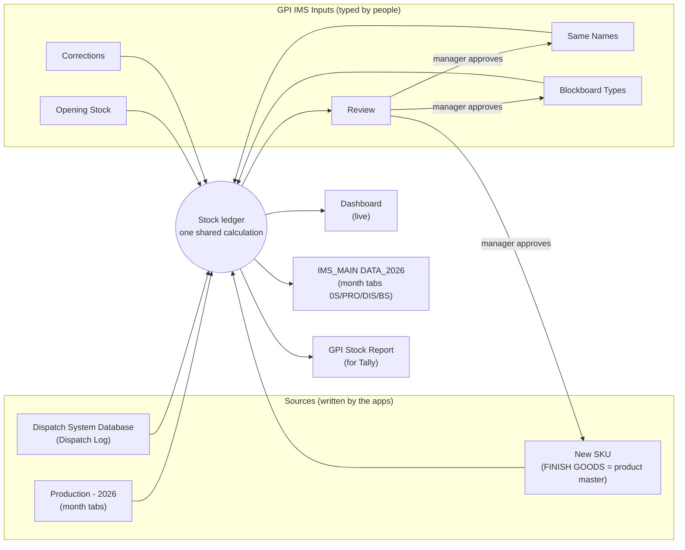

# GPI Finished Goods IMS

Inventory management for finished goods at **Ganesh Private Limited** (doors, plywood, blockboard and shuttering plywood).

It turns the entries made in the **Production app** and the **Dispatch app** into a day-by-day stock for every product. The same numbers appear in four places:

- a live dashboard
- the classic month-wise IMS sheet
- a Google Sheet ready for Tally import
- a Review list where spelling mismatches and new products are approved by a manager

Everything runs on Google Sheets and Google Apps Script. Nothing to host, nothing to install on a PC.

---

## Table of contents

- [Why this exists](#why-this-exists)
- [How it works](#how-it-works)
- [Components](#components)
- [The stock calculation](#the-stock-calculation)
- [How names are matched](#how-names-are-matched)
- [The Review workflow (spelling check and approvals)](#the-review-workflow-spelling-check-and-approvals)
- [Setup](#setup)
- [Daily use](#daily-use)
- [Configuration](#configuration)
- [Maintenance rules](#maintenance-rules)
- [Troubleshooting](#troubleshooting)
- [Known limitations](#known-limitations)
- [Repository layout](#repository-layout)
- [Version history](#version-history)

---

## Why this exists

The old IMS matched products by the text typed in each app. The same product was spelled differently in the SKU master, the Production app and the Dispatch app. Examples:

- `MR JABRA` / `JABRA`
- `BALWAN HD` / `BALWAN`
- `COMMERCIAL MR` / `GENERAL MR`

As a result:

- one product showed up as several rows
- stock was split across those rows
- quantities that matched nothing were silently lost

This system fixes that in three ways:

1. **One product list.** The **New SKU** sheet (tab `FINISH GOODS`) is the only list of products. Every product has exactly one row and one unique SKU code.
2. **One calculation.** The dashboard, the IMS, the Tally report and the Review list all run the same calculation code, so their numbers always match.
3. **Nothing is lost silently.** Any entry that does not match a product goes to the **Review** tab with the reason and a suggested fix. A manager approves the fix, and it is applied automatically.

---

## How it works



The flow, step by step:

1. Operators keep entering loads and dispatches in their apps exactly as before.
2. Every hour, each script reads the sources and runs the stock ledger.
3. Each output is rewritten with the same numbers: the IMS month tabs, the Tally report and the Review list. The dashboard reads the sources live whenever it is opened.
4. A manager decision in the Review tab is applied immediately. The decision either adds a name pair to Same Names, adds a product to New SKU, or confirms a Blockboard type. Every output picks the change up on its next refresh.

---

## Components

| Component | Type | What it does | Who uses it |
|---|---|---|---|
| **New SKU** (`FINISH GOODS` tab) | Google Sheet | Master list of products and SKU codes | Admin; Review adds to it |
| **Production - 2026** | Google Sheet | One tab per month, one row per press load (written by the Production app) | Read only |
| **Dispatch System Database** (`Dispatch Log`) | Google Sheet | One row per dispatched item (written by the Dispatch app) | Read only |
| **GPI IMS Inputs** + `IMS_Review.gs` | Google Sheet + Apps Script | Control panel: opening stock, corrections, name pairs, Blockboard types, Review approvals | Store / MIS team, manager |
| **IMS_MAIN DATA_2026** + `StockLedger_MainSync_v4.gs` | Google Sheet + Apps Script | Classic IMS: one tab per month, 0S / PRO / DIS / BS per day | Everyone (view only) |
| **GPI Stock Report (for Tally)** + `GPI_StockReport.gs` | Google Sheet + Apps Script | Check Stock picker, Stock by Date, Closing Stock, Tally movements | Manager, accounts |
| **GPI Finished Goods Stock** dashboard | Claude dashboard (live) | Colour-coded stock, date and product views, Review list | Everyone |

### GPI IMS Inputs (the control panel)

This is the only file people type into. Yellow cells are inputs.

| Tab | Purpose |
|---|---|
| **How to use** | Short instructions |
| **Review** | Unmatched entries, the suggested fix, the manager decision and the status (filled by `IMS_Review.gs`) |
| **Opening Stock** | Physical counts: `Count date`, `SKU code` (dropdown), `Pieces`, `Note`. **Product (auto)** shows the product name. |
| **Corrections** | Stock fixes: `Date`, `SKU code`, `Pieces (+ add, - remove)`, `Reason`, `Entered by` |
| **Same Names** | A name used in an app and the New SKU name it means. Only rows with `Confirmed = YES` are used. |
| **Blockboard Types** | Which Core thickness / Frame / Filler make which New SKU Blockboard type. A blank cell means "any". Only `YES` rows are used. |
| **Product List** | Live copy of New SKU (`IMPORTRANGE`). It feeds the SKU code dropdowns. Do not type here. |

Rows whose Note or Reason starts with `Example` are ignored.

### IMS_MAIN DATA_2026 (classic IMS)

Each month tab (`OCTOBER-26`, `NOVEMBER-26`, …) is laid out like this:

| Row / column | Content |
|---|---|
| Row 1 | Dates (A1 holds the legend) |
| Row 2 | `Category | type | Weight | face | thickness | size`, then `0S PRO DIS BS` for day 1 and `PRO DIS BS` for every later day |
| Row 3 | `TOTAL — ALL PRODUCTS` (SUM formulas) |
| Row 4+ | One row per New SKU product. A note on column A shows the SKU code. |
| Bottom (orange) | Entries that could not be counted. The note says why. |

- **BS** is the closing stock from the shared calculation, so it includes corrections and physical counts. A BS cell gets a note on days with a count or a correction.
- Negative stock is shown in red.
- Days after today stay blank.
- A new month tab is created automatically.
- Month tabs before the stock start date are left untouched as history.

Menu: **📦 Stock Ledger → 🔄 Refresh Everything / 🧱 Rebuild ALL months**

### GPI Stock Report (for Tally)

| Tab | Content |
|---|---|
| **Check Stock** | Pick a **Date**, a **Product**, or both, and the matching rows appear. Closing is colour-coded. Your choices survive refreshes. |
| **Stock by Date** | One row per product, one column per date, showing closing stock. Cells are coloured by stock level. |
| **Closing Stock** | Latest closing per product with its stock level |
| **Movements (Tally)** | One row per product per day per type, ready for Tally import:<br/>• `Production` (in)<br/>• `Dispatch` (out)<br/>• `Stock Correction` (in or out)<br/>• `Physical Count` (counted pieces) |
| **Daily Stock** | Every product, every day: opening, produced, dispatched, correction, closing. Check Stock reads from this tab. |
| **Needs Fixing** | Same list as the dashboard |
| **About** | Last update time and what each tab means |

Menu: **GPI Stock → Refresh now**

### Dashboard

A live dashboard that reads the same sources through the Google Sheets connector and runs the same calculation in the browser.

- **Stock levels bar.** Shows how many products fall in each colour. Click a colour to filter.
- **Products.** Tiles or a sortable table for any date, with search and category chips.
- **Product detail.** A day-by-day chart with the colour bands behind it, plus a full history table.
- **Needs fixing.** The Review list, with an *Open Review sheet to decide* button.
- **Google Sheet ↗.** Opens the Tally report.

---

## The stock calculation

Shared function: `ledger_` in every script; `Stock ledger` in the dashboard.

For every product, for every day:

```
Opening  = physical count (if one exists for that product on that day)
           otherwise yesterday's Closing (0 on the start day)
Closing  = Opening + Produced − Dispatched + Correction
```

**When stock tracking starts**
- The start date is the **earliest Count date** in Opening Stock.
- Before any count is entered, it is the 1st of the latest month with data. Products then start from 0, so some stock goes below zero until real counts are entered.

**Physical counts**
- A count is the stock at the **start** of its day, before 8 AM. Movements on that day are added on top.
- Counting again later resets the product to the new count from that date.
- Two count rows for the same product on the same date are added together (for example, two godowns).

**Other rules**
- **Corrections** are added on their date.
- **Negative stock is shown, not hidden.** It means stock that was never counted, or a missing entry.

**Dates**
- Production uses the app's production day (8 AM to 8 AM).
- Dispatch uses `Dispatch Date`, or the timestamp for old rows that have no Dispatch Date.
- Dates are read as `dd/mm/yyyy`.

---

## How names are matched

Every row becomes a **product identity**, which is then looked up in New SKU.

| Category | Identity |
|---|---|
| Door, Plywood, Blockboard | `Category · Thickness · Variety · Face · Size` |
| Shuttering | `Thickness · Weight · Glue · Brand · Size` (a blank glue in New SKU means "any glue") |

**Normalisation, applied to every source:**
- text is upper-cased with spaces collapsed
- `32mm`, `32MM` and `32 mm` all become `32`
- `30 KG` and `30kg` both become `30`
- `84"x37.5"` becomes `84X37.5`

**Production rows**
- **Doors:**
  - `MR Jabra` and `Jabra` become `JABRA`
  - `MR Fresh` and `MR` become `MR`, which Same Names maps to `FRESH`
- **Plywood:** ply type and glue become the New SKU variety:
  - `Red Core` + `MR` → `RED MR`
  - `Alt Core` + `PF` → `ALT PF`
  - `General MR` + `MR` → `GENERAL MR`
  - Older rows without glue are also handled.
- **Blockboard:**
  - `Jabra` becomes `JABRA`
  - If the app already wrote the New SKU type (for example `FRESH 2.5M PINE FRAME MR`), it is used as it is.
  - Otherwise the type comes from the **Blockboard Types** tab, matched on Core / Frame / Filler.

**Dispatch rows**
- The `Glue` column already holds the New SKU variety.
- For Shuttering, `Face` holds the brand.

**Same Names** (with `YES`) is applied to the variety, the face and the brand, for both sources.

A row that still does not match is **never guessed**. It goes to *Needs fixing* and the Review tab.

### SKU code pattern

| Category | Pattern | Example |
|---|---|---|
| Door | `DO-{thk}-{VAR}-{GLUE}-{FACE}-{SIZE}` | `DO-32-JAB-MR-OKU-72X24` |
| Blockboard | `BL-{thk}-{TYPE}-{GLUE}-{FACE}-{SIZE}` | `BL-19-F16-PF-GUR-8X4` |
| Plywood | `PL-{thk}-{TYPE}-{GLUE}-{FACE}-{SIZE}` | `PL-18-RED-MR-GUR-8X4` |
| Shuttering | `SH-{thk}-{WT}K-{GLUE}-{BRAND}-{SIZE}` | `SH-12-30K-PF-GPI-8X4` |

New codes are built from the nearest existing product, so the abbreviations stay consistent. They are always checked for uniqueness.

---

## The Review workflow (spelling check and approvals)

`IMS_Review.gs` runs every hour and whenever a decision is changed.

**1. Find.** It runs the shared calculation and collects every entry that did not match.

**2. Explain and suggest.** Each entry gets a problem and a suggested fix:

| Problem found | Example | Suggestion |
|---|---|---|
| Spelling difference (similarity ≥ 72%) | `BALWANN` vs `BALWAN` (90%) | Merge the name |
| Known product, new size / weight / glue | Woodnex 30KG **PF** | Add as new product (new unique code) |
| Name never seen | Brand `SUPER STAR` | Add as new product, or pick the right product |
| Size that cannot be right | Shuttering `6X16` | Fix the entry |
| Blockboard Core/Frame/Filler not confirmed | `2.5MM / PINE / MIXWOOD` | Confirm the Blockboard type (asked once per combination) |

Similarity uses edit distance and ignores spaces. A name that starts with the other name, like `BALWAN HD` vs `BALWAN`, also scores 90%.

The tool **never merges on its own**. For example, `WOODNEX` and `WOODRIX` are 71% alike but are different brands.

**3. Decide.** The manager discusses the row in **Remark / discussion** and picks a **Manager decision**:

| Decision | What happens automatically |
|---|---|
| ✅ Approve suggestion | Does what the Suggestion says (Same Names row, new New SKU row, or `YES` in Blockboard Types) |
| 🔁 Same as product in column M | Treats the entry as the product whose SKU code is picked in column M. Only names are merged; size, thickness and weight must match. |
| ➕ Add as new product | Appends the product to New SKU with a unique code (green row) |
| ✏️ Wrong entry – fix in app | Nothing changes; the entry must be corrected at source or with a Correction |
| 🚫 Ignore | The row is kept as Ignored |

**4. Track.** The Status column shows what happened:
- `New – waiting for decision`
- `Done ✔ …`
- `Waiting: fix the entry…`
- `Resolved ✔ no longer found`
- `Ignored`

IDs, decisions and remarks are kept across refreshes, so the tab doubles as an audit trail.

Menu: **🧠 IMS Review → 🔄 Refresh review list / ✅ Apply approved decisions now**

---

## Setup

### Prerequisites
- Google account with edit access to all the sheets listed under [Components](#components)
- The Production and Dispatch apps already writing to their sheets

### 1. GPI IMS Inputs + Review

1. Open **GPI IMS Inputs**, open the **Product List** tab, click cell A1 and press **Allow access**. This is a one-time `IMPORTRANGE` permission.
2. Go to **Extensions → Apps Script**, paste `apps-script/IMS_Review.gs`, and press **Save**.
3. Choose the function **`setup`**, press **Run**, and allow the permissions.
   - If Google shows *"app not verified"*, click **Advanced → Go to project**. It is your own script.
4. `setup` creates two triggers and fills the Review tab:
   - an hourly trigger (`applyAndRefresh`)
   - an on-edit trigger (`onReviewEdit`)

### 2. IMS_MAIN DATA_2026

1. Go to **Extensions → Apps Script** and replace the content of `StockLedger_MainSync.gs` with `apps-script/StockLedger_MainSync_v4.gs`. Press **Save**.
2. Run **📦 Stock Ledger → 🧱 Rebuild ALL months** once.
3. Keep the existing hourly trigger on `refreshAllData`. If it is missing, add a time-driven trigger: `refreshAllData`, every hour.

### 3. GPI Stock Report (for Tally)

1. Go to **Extensions → Apps Script**, paste `apps-script/GPI_StockReport.gs`, and press **Save**.
2. Run **`setup`** once. It creates an hourly trigger on `refreshStockReport` and fills all tabs.

### 4. Dashboard

- The dashboard reads the same sheets live. Each viewer needs the Google Sheets connector and read access to the sheets.

### 5. First real numbers

- Count the stock one morning before 8 AM.
- Enter the counts in **Opening Stock** and delete the example row.
- Stock is correct from that date on.

---

## Daily use

| Who | When | What |
|---|---|---|
| Operators | Every load / dispatch | Use the apps as usual. Nothing changed for them. |
| Scripts | Every hour | Refresh the IMS, the Tally report and the Review list |
| MIS / store | Daily | Check **Review**. Enter **Corrections** for damage or missed entries. |
| Manager | Daily or weekly | Decide Review rows. Download the Tally report and import **Movements (Tally)**. |
| Store | Monthly (or anytime) | Physical count into **Opening Stock**. It resets each counted product. |

**Golden rules**
- New SKU is the only product master. Products are added there or approved through Review.
- Only type in **GPI IMS Inputs**. The IMS and the Tally report are rewritten every hour.
- Never edit the Production or Dispatch sheets to fix stock. Use **Corrections**.

---

## Configuration

Sheet IDs are constants at the top of each script (`SRC`, `PRODUCTION_SHEET_ID`, etc.). Change them only if a file is replaced.

| Setting | Where | Default |
|---|---|---|
| Stock level colours | Dashboard `BANDS`; report `BANDS_` | 800+ purple · 500–799 green · 200–499 yellow · below 200 red |
| Spelling threshold | `IMS_Review.gs` → `SPELL_MIN` | `0.72` |
| Months read by the dashboard | Dashboard `production` loader → `LATER_MONTHS` | `October` (main call) + `November`, `December` |
| Refresh frequency | Apps Script triggers | Every hour |

> **Security note:** the scripts contain Google Sheet IDs. IDs do not grant access by themselves, but keep this repository **private**, or replace the IDs with placeholders before publishing.

---

## Maintenance rules

1. **The calculation must stay identical in all four places:**
   - `ledger_` in `IMS_Review.gs`, `StockLedger_MainSync_v4.gs` and `GPI_StockReport.gs`
   - `Stock ledger` in the dashboard

   Change it in one place and copy it to the other three in the same release. Check by comparing the function text (`fn.toString()`) across the files; they must be equal.
2. **Never reuse an SKU code.** Two products sharing a code breaks Opening Stock and Corrections for both.
3. **Prefer Same Names over editing app data** when an app uses an old name.
4. **Back up New SKU** before bulk edits: File → Make a copy.

---

## Troubleshooting

| Symptom | Cause | Fix |
|---|---|---|
| Product (auto) shows "Open the Product List tab and click Allow access" | `IMPORTRANGE` not authorised | Product List tab → click A1 → Allow access |
| Many products below zero | No opening count yet | Enter physical counts in Opening Stock |
| A product's numbers look too low | Some entries did not match | Check Review / Needs fixing for that product |
| Dashboard and sheet numbers differ | A script still runs an older version, or a refresh is pending | Update all scripts to the same release, then run Refresh |
| IMS still shows duplicate rows | Old IMS code (v3) still installed | Install `StockLedger_MainSync_v4.gs`, then 🧱 Rebuild ALL months |
| Review decision did nothing | On-edit trigger missing | Run `setup` again in GPI IMS Inputs, or use 🧠 IMS Review → ✅ Apply approved decisions now |
| Status shows "Can't merge: size, thickness or weight differ" | 🔁 points to a different-size product | Use ➕ Add as new product or ✏️ Fix the entry |
| Script error "Exceeded maximum execution time" | Very large month or many months | Use 🔄 Refresh (last 2 months) instead of Rebuild ALL |

---

## Known limitations

- **Year rollover.** Production data lives in a yearly workbook (`Production - 2026`). In January 2027, add the new workbook ID to the three scripts and to the dashboard's `production` source.
- **New SKU rows added by Review** fill columns A–G only. Technical columns (weight/sqft, layers, core requirement) must be filled by hand if used.
- **Blockboard production** needs the Blockboard Types rows confirmed. Until then, those loads stay in Review.
- **The dashboard** only reads; decisions are made in the Review sheet.
- **Time zone.** The scripts assume Asia/Kolkata. Production and dispatch dates must be `dd/mm/yyyy`.

---

## Repository layout

```
.
├── README.md
├── apps-script/
│   ├── IMS_Review.gs                 # GPI IMS Inputs: spelling check, Review, approvals
│   ├── StockLedger_MainSync_v4.gs    # IMS_MAIN DATA_2026: month tabs 0S/PRO/DIS/BS
│   └── GPI_StockReport.gs            # GPI Stock Report: Check Stock, Stock by Date, Tally
└── docs/
    └── sheet-structure.md            # optional: column lists of each source sheet
```

---

## Version history

| Date | Component | Change |
|---|---|---|
| 8 Oct 2026 | IMS v3 | Single workbook with month tabs; spelling pairs kept inside the code |
| 26 Oct 2026 | Dashboard | Live dashboard on real data; colour system; date and product views |
| 26 Oct 2026 | GPI IMS Inputs | Opening Stock, Corrections, Same Names, Blockboard Types |
| 26 Oct 2026 | Tally report v2 | Check Stock picker, Stock by Date, Movements for Tally |
| 26 Oct 2026 | New SKU cleanup | 9 duplicates removed, 30 shared codes made unique, 42 spellings fixed, 43 real products added (2,240 unique products) |
| 26 Oct 2026 | IMS v4 | Same layout as v3, numbers from the shared calculation, one row per New SKU product |
| 26 Oct 2026 | Review v1 | Automatic spelling / new-product detection with manager approval |
